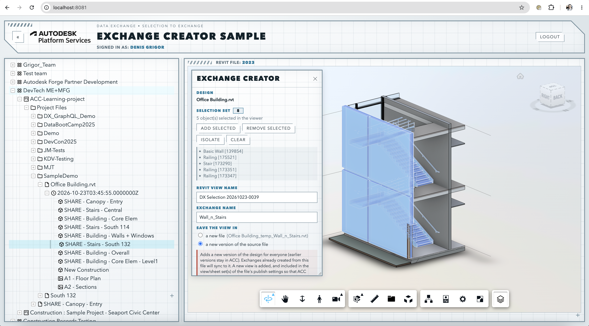

# APS Exchange Creator (.NET)

[](https://dotnet.microsoft.com/)
[](http://opensource.org/licenses/MIT)

## Description

This sample creates a [Data Exchange](https://aps.autodesk.com/data-exchange-api) from a **selection set** of elements picked in the Viewer, instead of from a published view.

It is based on the [Hubs Browser](https://github.com/autodesk-platform-services/aps-hubs-browser-dotnet) sample, extended with:

- a **Viewer extension** (built as described in the [Dashboard tutorial](https://get-started.aps.autodesk.com/tutorials/dashboard/basic)) for building the selection set and tracking the progress,
- a **Revit add-in** running in [Design Automation for Revit](https://get-started.aps.autodesk.com/tutorials/design-automation/) that creates a view showing only the selected elements,
- a call to the [Data Exchange GraphQL API](https://autodesk-platform-services.github.io/aps-dx-graphql-tutorial/mutation/home/) that creates the exchange from that view.

The Viewer shows each step as the job goes: saved the selection list, prepared Design Automation, uploaded the Revit design, created the view in Revit, received the processed design, processed it in ACC, and created the exchange. Elements are matched between the Viewer and Revit by their **external ID** (the element's `UniqueId`).


## Thumbnail



## Dependencies

- **[.NET 8 SDK](https://dotnet.microsoft.com/download)** (plus the .NET 10 SDK if you build the add-in for Revit 2027).
- **APS account**: [create an app](https://aps.autodesk.com/myapps) with the callback URL `http://localhost:8081/api/auth/callback`, with access to the Data Management, Model Derivative, Design Automation and Data Exchange APIs.
- The app's client ID added as a **custom integration** in your ACC account ([instructions](https://get-started.aps.autodesk.com/#provision-access-in-other-products)).
- An ACC project containing a **Revit file (`.rvt`)** uploaded to Docs. (Revit cloud workshared models can't be processed by Design Automation.)

## Running locally

Everything the app does with ACC needs a 3-legged token, so you sign in through the browser. The tokens are kept in cookies and refreshed automatically. 

### 1. Build the Revit add-in (app bundle)

Build one bundle per Revit version you want to support (2024 to 2027 today):

```bash
for v in 2024 2025 2026 2027; do dotnet build RevitPlugin -c Release -p:RevitVersion=$v; done
```

This produces `RevitPlugin/bin/Release/<version>/ExchangeViewCreator.zip`. The Revit API comes in as reference-only NuGet packages, so you can build it on any OS without Revit installed.

### 2. Set the APS credentials

```bash
export APS_CLIENT_ID="your client ID"
export APS_CLIENT_SECRET="your client secret"
export APS_CALLBACK_URL="http://localhost:8080/api/auth/callback"
# optional:
export APS_DA_BUNDLES_PATH="../RevitPlugin/bin/Release"   # folder with one <version>/ExchangeViewCreator.zip per Revit version
export APS_DA_MIN_REVIT_VERSION=2025                      # older designs are upgraded at least to this version
```

### 3. Run the app

```bash
cd WebApp
dotnet run
```

### 4. Open the app

Open [http://localhost:8080](http://localhost:8080) and log in. Browse to a Revit file, click one of its versions to load it, open the **Exchange Creator** panel with its toolbar button, select elements in the Viewer and click **Add selected**, then **Create exchange**. The exchange and a `<name>_temp_<exchange name>.rvt` file end up in the same ACC folder as the source file.

The default port is 8080, but you can change it in `WebApp/Properties/launchSettings.json`and it is important to match the port used in the callback url.

## Known issues

- **Cloud workshared models** can't be processed: they have no downloadable file in ACC. Use models uploaded to Docs as `.rvt` files.
- **Jobs are kept in memory**, so they are lost when the server restarts, and a job only progresses while the page is open.
- **Saving the view in the source file** adds a new version of the design for everyone, upgrades older designs and changes the file's publish settings.

## Further reading

-  [Hubs Browser tutorial](https://get-started.aps.autodesk.com/tutorials/hubs-browser/) to understand how the web app was generally created. 
- [Dashboard tutorial](https://get-started.aps.autodesk.com/tutorials/dashboard/) to understand how the extension was created.
- [Revit plugin development tutorial](https://get-started.aps.autodesk.com/tutorials/design-automation/prepare-plugin) to understand how Automation service ready Revit add-in is created
- [APS Data Exchange GraphQL tutorial](https://autodesk-platform-services.github.io/aps-dx-graphql-tutorial/) to understand what calls were used to create exchange from the Revit view
- [Exchange Maker](https://github.com/autodesk-platform-services/aps-dx-graphql-exchange-maker-net): sample illustrating how to create an exchange from a published view, a filter or IFC classes
- [Exchange Monitor](https://github.com/autodesk-platform-services/aps-dx-graphql-exchange-monitor-net): sample illustrating how exchanges can be used to quickly identify if the needed part of the source model were changed


## License

This sample is licensed under the terms of the [MIT License](LICENSE).
